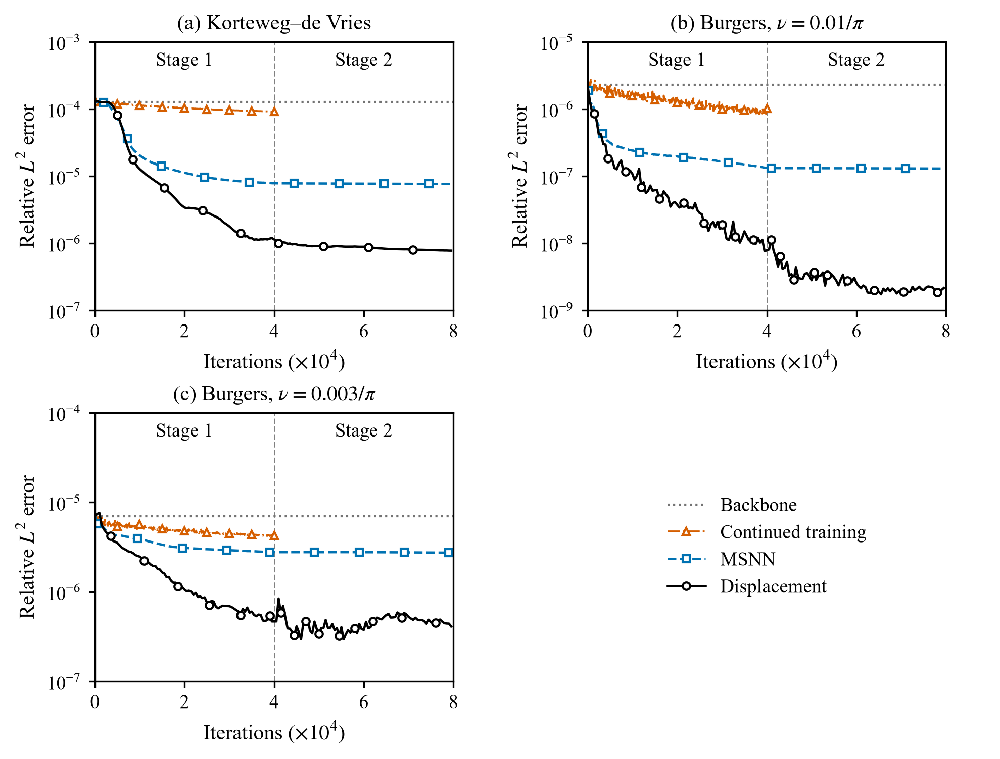

# Displacement correction of trained physics-informed neural networks

Reference implementation of the displacement correction, a correction of a trained PINN (the backbone) after
training. A second network, the corrector, outputs a displacement of the backbone and a remainder, and it is
trained on the original equation evaluated at the corrected field as in multi-stage neural networks (MSNN). The
comparison is the additive correction of MSNN with the same corrector, loss and number of iterations, and the
backbone trained for as many more iterations. The backbones are trained with
[jaxpi2](https://github.com/sifanexisted/jaxpi2), which is used without changes, and everything runs in float64.



Relative L2 error against the iterations of two stages of MSNN and of the displacement correction, with continued
training and the backbone error, mean over three seeds.

## Layout

```
code/release/
  src/
    x64.py              float64 for jaxpi2 without editing it (parameters, SOAP and schedule-free states)
    pdes.py             kdv, burgers and burgers_nu3: residuals on jets, model and data as each example builds them
    correction.py       the corrector (a jaxpi2 ForwardIVP), both forms of the correction, stages
  examples/burgers_nu3/ the jaxpi2 burgers example with the viscosity 0.003 / pi and its reference data
  experiments/
    run_jaxpi2.py       train a jaxpi2 example unchanged (backbones, continued training)
    run_correction.py   one correction stage (--form disp | add, --prev for a second stage)
    eval_backbone.py    errors of a backbone or of its continued training
    make_references.py  converged reference of the jaxpi2 burgers example
    make_data.py        reference data of burgers_nu3
    grid.py             every run as jobs for pool.sh
    pool.sh             GPU job pool with priorities and dependencies
  figures/
    results.py          collects the errors of the runs into results/
    fig_curves.py       errors against the iterations, the figure above
    tables.py           errors of every run for each seed
    figlib.py           style and paths
  setup_external.sh     clones jaxpi2 at the pinned commit into code/external/jaxpi2
  envs_setup.sh         the Python environment in envs/v2
results/
  errors.json           final error of every run
  curves.json           error against the iterations of every correction and of continued training
```

Scripts locate themselves, so they can be run from anywhere; runs go to `runs/`, the figure to `paper/figures/`
and the table to `paper/tables/`.

## Requirements

Python 3.12 with JAX 0.10.2 on a CUDA GPU, and jaxpi2 at the commit this work used. `requirements.txt` pins the
versions this release was run and verified on. The two setup scripts clone jaxpi2 and install everything into
`envs/v2`:

```bash
bash code/release/setup_external.sh
bash code/release/envs_setup.sh
```

## Running

The converged Burgers reference (the released one is not converged), workers for the job pool, and every run:

```bash
PY=envs/v2/bin/python
E=code/release/experiments
$PY $E/make_references.py burgers runs/references
for g in 0 1; do for i in 1 2 3 4 5 6; do nohup $E/pool.sh worker $g 6000 > /dev/null 2>&1 & done; done
$PY $E/grid.py --submit
```

When every job is done, the errors are collected into `results/`:

```bash
$PY code/release/figures/results.py
```

The figure and the table, from `results/` and without any training:

```bash
$PY code/release/figures/fig_curves.py
$PY code/release/figures/tables.py
```

A correction stage needs about 4 to 6 GB of GPU memory.

## What is here

`results/` holds the errors behind the paper's main comparison, so the figure and the table can be made without a
GPU. The trained networks are not part of this repository; they are available from the authors on request.

## Benchmarks

All three are posed on x in [-1, 1] with periodic boundary conditions and t in [0, 1], on the grid of the jaxpi2
data with 201 times and 512 points in x. The backbones are PirateNets trained with the jaxpi2 configuration of each
example for the seeds 42, 43 and 44.

| name        | equation                       | initial condition | reference                             |
|-------------|--------------------------------|-------------------|---------------------------------------|
| kdv         | u_t + u u_x + 0.022^2 u_xxx = 0 | cos(pi x)         | jaxpi2 data                           |
| burgers     | u_t + u u_x - nu u_xx = 0      | -sin(pi x)        | nu = 0.01 / pi, make_references.py   |
| burgers_nu3 | u_t + u u_x - nu u_xx = 0      | -sin(pi x)        | nu = 0.003 / pi, make_data.py        |

## Citation

```bibtex
@article{hwang2026displacement,
  title  = {Displacement correction of trained physics-informed neural networks},
  author = {Hwang, Mikyung and Choi, Minseok},
  year   = {2026}
}
```

## License

MIT, see `LICENSE`. `code/release/examples/burgers_nu3` is adapted from the jaxpi2 burgers example and keeps its
Apache 2.0 license, see the `NOTICE` there.
